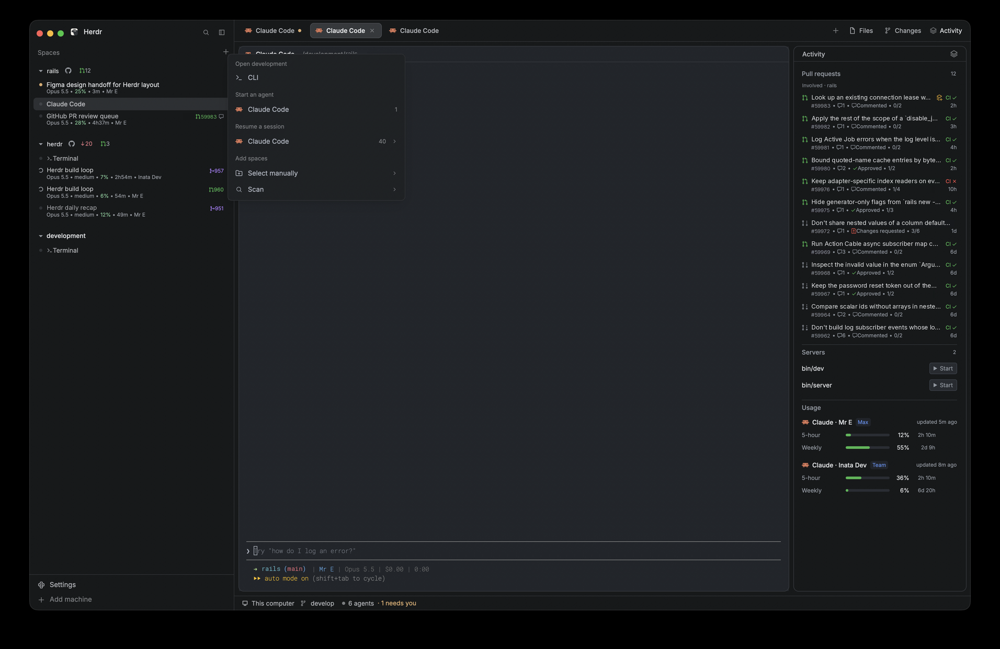

# Clarter UI for Herdr

A layout for [Herdr](https://herdr.dev): spaces and the agents running in them in one sidebar,
and an Activity panel with your pull requests, dev servers and plan limits.



| Layout | |
| --- | --- |
| [Clarter UI](clarter-ui/) | spaces with their agents, PR states, and an Activity panel with PRs, servers and usage |

## Install

Ask your agent in Herdr to add `https://github.com/etoundi2nd/clarter-ui/tree/main/clarter-ui`,
or copy it by hand:

```sh
cp clarter-ui/layouts/clarter-ui.json ~/.config/herdr-app/layouts/
cp -R clarter-ui/mods/clarter-ui clarter-ui/mods/clarter-ui-pane ~/.config/herdr-app/mods/
herdr-app do layout.switch '{"name":"clarter-ui"}'
```

Then merge `clarter-ui/keys.json` into `~/.config/herdr-app/keys.json` for `cmd-alt-b`
(Activity panel). Needs `python3`, and `gh` signed in for the GitHub parts.
[Over9k](https://github.com/herunan/herdr-over9k)'s launcher is used for the + menus when
installed. `clarter-ui/RECIPE.md` describes everything it does and assumes.

## License

MIT. `claude-info.py`, `pr-info.py` and `agent-name.js` come from Over9k (MIT).
