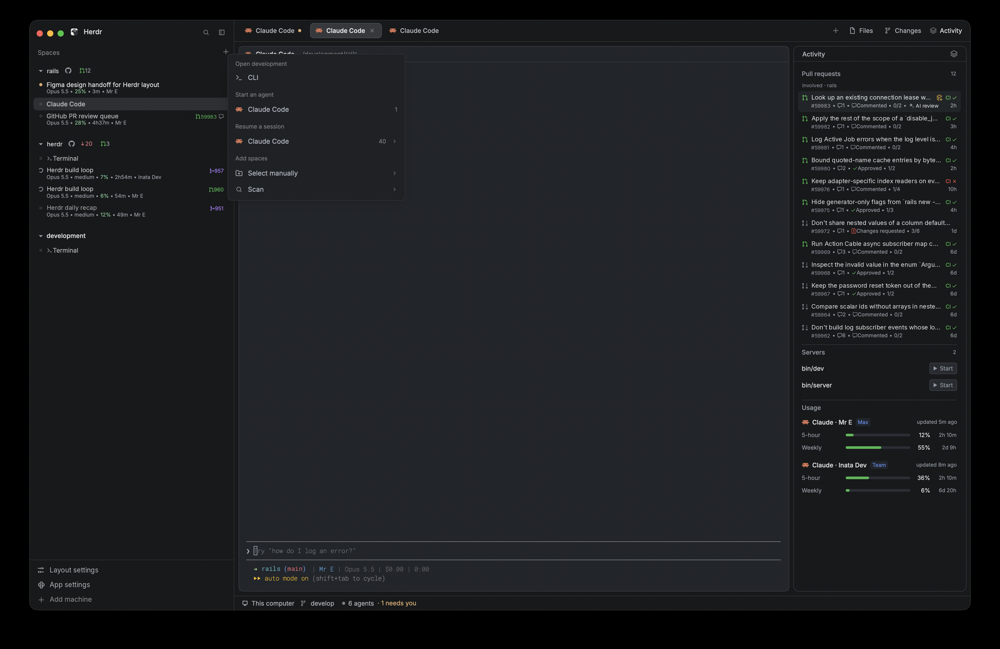

# Clarter UI

A dark, quiet Herdr window for working with many coding agents at once. The left sidebar
lists every space with the agents and terminals running in it, each with its model, effort,
context, time and pull request. The right Activity panel shows the open pull requests that
involve you in the shown space's repo, the repo's dev servers, and the plan limits of every
Claude account with a session open.

## What you see

Left to right: a 311px sidebar, the work column, and a 288px Activity panel that starts hidden.
The app background is `#17191b`, terminals sit on `#22262b`, text is Inter.

- **Sidebar** (resizable 44–520px, `#17191b`):
  - Brand row, 46px, draggable: the Herdr mark (16px) and "Herdr" at x 78, a search button and a
    sidebar-fold button on the right.
  - "Spaces" header (35px, `#7c7f82`, 12px) with a + that opens a terminal in a new space on
    `~/development` (or the home folder when there is none).
  - One block per space, 12px apart:
    - a 32px header: a triangle (`#969ba2`) that turns into the space's close button on hover,
      the name (12px, weight 500, `#dddfe2`), which folds the space, and chips: GitHub, commits behind upstream (`#d7747d`, arrow down), open pull
      requests that involve you (`#969ba2`), and a + that appears on hover.
    - its sessions: 36px rows with a details line, 24px rows without one. A status mark at x 11,
      the title from x 25 (37 for a plain terminal, after a `>_` icon), and on the right the
      session's pull request chip and a sub-agent count. A session on several pull requests
      shows "PR n" with a chevron instead; it opens a dropdown of those PRs as Activity rows.
    - The details line (10px, `#969ba2`): model • effort • context % (`#77be8f`) • time since the
      last reply, then the account's user name once this computer has more than one Claude account.
  - Footer, 97px: Layout settings, App settings (a blue dot when an update is ready) and Add
    machine.
  - Folded under 160px wide, the sidebar becomes a rail of 24px space badges.
- **Toolbar**, 42px, draggable: the shown space's tabs as pills (29px high, radius 7; the active
  one `#36393d` with a `#4a4e53` border and a close ×), a + menu, and Files, Changes and Activity
  toggles.
- **Panes**: radius 10, `#363a3f` border, `#82b7ed` when focused, 8px gaps. A 30px header with
  the program icon, its name, the folder (`#7c7f82`), a spinner while working, and split right,
  split down, zoom and close on hover.
- **Activity panel** (radius 10, border `#363a3f`), sections split by 1px `#303438` lines:
  - **Pull requests**: open PRs involving you in the repo (`gh` `involves:@me`), 40px rows,
    at most half the panel's height, scrolling beyond. Each row: the lifecycle icon, title, CI
    mark, then number, comments, review state and approvals, and age. On hover an "AI review"
    button follows the approvals.
  - **Servers**: `bin/dev`, `bin/server`, `bin/servers` when the repo has them, each with
    Start / Stop.
  - **Schedules**: the scheduled runs whose folder is the space's or its repo's (one row per task
    and account), with when the next one runs and how the last went, a Start button for a run now
    (a spinner while one is live) and an on/off switch.
  - **Usage**: one block per Claude account with a session open (plus Codex), with its plan badge
    (`#5b8fee` on `#20252b`), "updated Nm ago", and 5-hour, weekly and Opus bars (green, amber
    from 70%) with time to reset.
  - **This session**: the focused agent's context bar and model, effort and prompt-cache time.
- **Status bar**, 28px: this computer or the machine, the branch, and the agent count with how
  many need you.

GitHub states use GitHub's own icons and colours: open `#3fb950`, draft `#9198a1`, queued
`#d29922`, merged `#ab7df8`, closed `#f85149`; their meanings are in the tooltips.

## How it behaves

- **Status marks**: working is a 12px spinner; blocked an amber dot `#dcab6c`; done a blue dot
  `#6ba9e9`; idle a grey dot `#777e86` at 25% opacity, with the title at 75%.
- Hovering a session row turns its status mark into a close button (closes the pane, or kills a
  sub-agent's terminal).
- **Empty spaces stay**: closing a space's last session (from its row or the tab's ×) leaves the
  space with a "No sessions" tab offering New tab or agent, since Herdr closes a space with its last
  tab. The tab goes once another tab opens there. Close the space from its header's triangle. Clicking a row focuses that pane; right-click opens Herdr's pane menu.
- **Titles**: a name you gave wins; else the agent's own task title; else the program, so a
  fresh Claude reads "Claude Code"; a plain shell reads "Terminal". Long titles end in "…"; the
  chips on the right never leave the row.
- **One space per folder**: every 10 seconds a tab whose terminals all sit in another space's
  folder moves into that space, and spaces opened on the same folder merge under the folder's
  name. A space emptied by a merge is removed; one emptied by a move keeps a "No sessions" tab. The view follows the focused tab.
- The behind chip pulls (`git pull --ff-only`); the GitHub chip opens the repo; the PR chips
  open the PR. A PR with a review you haven't opened yet shows a mark until you click it.
- **Layout settings** (a dialog; also the `clarter-ui.settings` command): the AI commands, such
  as shell aliases that sign in to a particular account, the one AI review runs, and the review
  prompt (`{url}`, `{number}`, `{title}`). Kept in shared `clarter-ui.settings`.
- **AI review** opens a tab named `Review #N` in the repo's folder, runs the selected command in
  your interactive shell (aliases and functions work) and sends the review prompt as its first
  message.
- `cmd-alt-b` toggles the Activity panel; Files and Changes share the same panel.
- Usage refreshes every 10 minutes; agent details every 10 seconds; PRs every 30 seconds.

## Built from

- `layouts/clarter-ui.json`: a root `row` (titlebar none, traffic lights at 13,18) of the
  `sidebar` column (blocks `brand`, `spaces`, `sidebar-footer`) and the `work` column (blocks
  `toolbar`, `work-body` row, `status`). `work-body` holds `main` (the tab, panes as cards with a
  `clarter-ui-pane` header) and the hidden `panel` column with a `panel-body` stack of `activity`,
  the shipped `files` and the shipped `changes`.
- `mods/clarter-ui`: one mod; `props.role` picks brand, spaces, footer, toolbar, activity,
  status, settings (the dialog), prlist (a session's PR dropdown) or empty (the "No sessions"
  tab, `empty.js`). `tokens.js` holds the colours; `github.js` the PR states, the PR row and AI review.
- `mods/clarter-ui-pane`: the pane header.
- Herdr functions: `spaces`, `panes`, `agents`, `terminals`, `focused`, `layout`, `window`,
  `shared`, `setShared`, `exec`, `openOverlay`, `nextCommand`; commands `space.select`,
  `space.rename`, `tab.new`, `tab.select`, `tab.close`, `tab.rename`, `pane.focus`, `pane.close`,
  `pane.split`, `pane.zoom`, `terminal.kill`, `terminal.peek`, `layout.show`, `layout.hide`,
  `layout.select`, `layout.resize`, `app.settings`, `mod.open`.
- Shipped mods it opens: `menu`, `picker`, `machine-add`, `files`, `changes`, `new-menu`; icons
  from `workspace-chrome` and `pane`.
- Programs it runs (`exec`): `python3` with its own scripts, `gh`, `git`, `ps`, `open`, `test`, and
  `herdr-task` when installed (`list --json` with each row's `cwd` and `next_at`, `run-now`, `on`/`off`
  per task and account; its runs' terminals carry the `herdr-task` labels).
  - `claude-info.py` and `pr-info.py` (from Over9k, MIT): each Claude Code session's model,
    effort, context and pull requests, from Claude Code's own files.
  - `github.py`: PR state, review, CI and conflicts, a folder's repo and commits behind, and
    `git pull --ff-only`. Answers are cached in `~/.cache/clarter-ui`.
  - `accounts.py`: which Claude account each session runs under (`CLAUDE_CONFIG_DIR` in the
    process's environment, else `~/.claude`) and each account's saved limits.
  - `arrange.py`: moves tabs between spaces by editing the app's layout doc through
    `herdr-core connect` (Herdr has no command for it).
- Art: GitHub Octicons and icons exported from the layout's Figma design.

## Watch out

- It reaches the network only through `gh` (GitHub) and `git pull`. It reads Claude Code's files
  under `~/.claude*` and `~/.claude.json`, and Codex's under `~/.codex`.
- Plan limits are what each account's status line last saved: `<profile>/usage.json` as
  `{at, rate_limits}`, or Over9k's `~/.cache/over9k/usage/claude.json` for `~/.claude`. Without
  a status line that saves them, Usage shows only Codex.
- Moving tabs by folder is eager: `cd` a terminal into another space's folder and it moves
  there. Tabs named `⏰ …` (scheduled runs) keep that name when moved.
- The + menus use Over9k's launcher (`over9k-new-menu`) when it's installed, else Herdr's
  `new-menu`, which ignores the Spaces header's folder.
- `overflow_y_scrollbar` needs a definite height: the PR list gets one from the panel's measured
  size.
- Without `herdr-task` on the PATH (or in `~/.local/bin`) the Schedules section stays hidden.
- `gh` must be signed in; without it the PR chips, PR list and repo chips stay empty.
- A layout name with a space is not loaded; keep `clarter-ui`.

## Done when

- `herdr-app check mods/clarter-ui` and `mods/clarter-ui-pane` pass and
  `layout.switch {"name":"clarter-ui"}` shows the window above.
- A running Claude Code row shows its model, context and time; with two Claude accounts signed
  in, each row also names its account user.
- Hovering a row shows the close button; clicking it closes the pane.
- Hovering a PR row shows AI review; clicking it opens a tab running the selected AI command
  with the review prompt.
- `cmd-alt-b` and the Activity button show and hide the panel; in a GitHub repo it lists your
  open PRs, scrolling once they fill half the panel.
- The space header's + appears only on hover; clicking the name folds the space; hovering the
  triangle shows a close button that closes the space.
- Closing a space's last session leaves the space with its "No sessions" tab.
- Opening a terminal in a space and `cd`-ing into another space's folder moves its tab there
  within 10 seconds.
